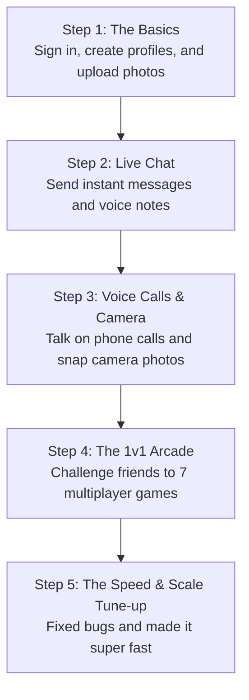
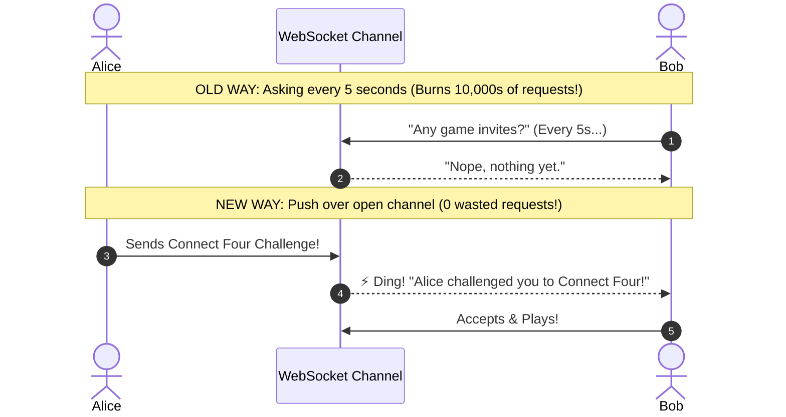

# DataVerse: The Beginner-Friendly Story & Guide

---

## 1. Welcome to DataVerse! (What is this app?)

Imagine taking three of your favorite apps and putting them into one super-fast experience:
1. **Instagram**: A feed where you can post photos, videos, and write captions, like posts, and organize things into collections.
2. **WhatsApp**: A real-time chat where you can send text, voice notes, and make live phone calls to your friends.
3. **An Arcade**: A multiplayer gaming room where you can challenge your friends to 1v1 games like *Connect Four, Chess, Checkers, Word Duel, and Dots & Boxes*.

All of this was built to run inside a phone browser or computer **without needing to install an app from the App Store or Play Store**.

---

## 2. What Ingredients (Languages & Tools) Were Used?

Think of building an app like building a house. Here are the materials we used:

| Tool / Language | What It Is in Simple Words | Real-Life Analogy |
| :--- | :--- | :--- |
| **TypeScript** | JavaScript with safety goggles. It catches typos and bugs before the code ever runs. | A spell-checker for code that stops you from making mistakes. |
| **React** | A tool that lets us build the screen out of reusable Lego blocks (buttons, cards, chat bubbles). | Lego bricks that snap together to build the user interface. |
| **Tailwind CSS** | A styling system for colors, rounded borders, animations, and dark mode. | The paint, neon lighting, and interior decoration of the app. |
| **Vite** | A lightning-fast engine that bundles all the code into tiny, lightweight files for phones. | A super-packer that fits an entire suitcase into a small backpack. |
| **Cloudflare Workers** | "Serverless" mini-computers running in 300+ cities around the world. | Instead of one big computer in one building, you have mini-helpers stationed in every major city on Earth. |
| **Cloudflare D1** | A fast, cloud-based database where user profiles, posts, and comments are stored. | A giant digital filing cabinet. |
| **WebSockets** | A phone line that stays open between your phone and the server for instant chatting. | An open walkie-talkie channel where both people can talk with 0 delay. |
| **WebRTC** | A special technology that connects two phones directly to each other for voice calls. | Two phones talking directly with two cans and a string—no server in the middle! |

---

## 3. How DataVerse Was Built (Step-by-Step)

1. **The Foundations**: We built user accounts, security passwords, a clean dark-mode UI with green neon highlights, and the photo feed.
2. **Real-Time Messaging**: We added instant chat rooms so friends can send messages, send reactions (❤️, 😂), and see when the other person is typing.
3. **Voice Calling & Camera**: We built a built-in camera that can flip between front and back lenses, and audio calling so you can speak to friends in real time.
4. **The Multiplayer Arcade**: We added 7 fun games so friends can play games against each other inside the app.
5. **The Big Tune-Up**: We hunted down bugs on mobile phones, made buttons easy to tap, and made the servers run so efficiently that they can handle thousands of users for free.

---

## 4. The "Oops!" Moments: Big Problems We Faced & How We Fixed Them

Building a complex app always brings interesting problems. Here are the biggest ones we solved:

### Problem 1: The "Black Screen" in the Admin Photo Viewer
* **What Happened:** When an admin tapped the eye icon to inspect a photo, the screen turned dark, but the photo never appeared—it stayed pitch black! Worse, the bottom menu bar stayed bright and floated over the screen.
* **Why It Happened:** The photo viewer was trapped inside an invisible box with special 3D styles, which pushed it *behind* the bottom menu bar! Also, the photo had an empty height box, so the browser collapsed it to zero pixels tall.
* **The Fix:** We used something called a **React Portal**. It lifts the photo viewer out of its trapped box and attaches it directly to the very top layer of the screen (`document.body`). We also made sure the photo always has a minimum size and shows a friendly loading shape while it downloads.

### Problem 2: The "Ghost Click" on Phone Comments
* **What Happened:** When people tapped the comment button (`💬`) on mobile phones, the comment box would open for a split second and then instantly snap shut!
* **Why It Happened:** When your finger taps a glass phone screen, the phone sends two signals: a "touch" signal, followed 0.3 seconds later by a fake "click" signal. That second fake click was hitting the background and telling the app to close immediately!
* **The Fix:** We put a 0.45-second timer on the comment box. If a click arrives in less than half a second after opening, the app knows it's a ghost click and ignores it!

### Problem 3: The "Slippery Feed" When Typing a Comment
* **What Happened:** Whenever you opened the comment box on a phone, scrolling through the comments would accidentally scroll the posts in the background!
* **Why It Happened:** Mobile phone browsers love to keep scrolling the main webpage even when a popup window is open.
* **The Fix:** We locked the background webpage in place by memorizing where you were standing, freezing the body (`position: fixed`), and letting only the comment box scroll. When you close the comments, your feed returns to the exact same spot with zero jumping!

---

## 5. The "100k Speed Trap": Why the App Was Burning Out and How We Fixed It

### The Problem:
Cloudflare gives us **100,000 free server requests per day**. At first, just two people testing the app for a few hours burned through almost half of that daily limit! Why?

Imagine you have a friend named Alex. Instead of Alex calling you when he has a message, imagine you ask Alex:
> *"Alex, do you have a message for me?"* (5 seconds later)  
> *"Alex, do you have a message for me?"* (5 seconds later)  
> *"Alex, do you have a message for me?"*

You would be asking Alex **720 times every hour** even when nobody is talking! 
That's called **Polling**, and our app was doing it for:
- Chat conversations (every 5 seconds)
- Game invites (every 7 seconds)
- Unread messages (every 15 seconds)
- Live posts (every 25 seconds)

### The Solution:
We replaced the asking loop with **Push Notifications & WebSockets**:
* Instead of asking Alex every 5 seconds, Alex simply rings your bell **only when he actually has a message**.
* **Result:** We deleted the 5-second and 7-second timers. When your friend challenges you to a game, it travels over the open WebSocket line instantly with **0 wasted requests**!

---

## 6. Real-Life Analogies for Tech Concepts

Here is a quick cheat sheet for the technical words:

* **WebSocket:** Like keeping a phone call open on speakerphone so either person can talk anytime, instead of sending letters in the mail back and forth.
* **WebRTC (Audio Calls):** Like talking through two paper cups connected by a tight string. Your voice travels directly to your friend's phone without the server listening or relaying the sound.
* **Edge Caching:** Storing popular photos in local convenience stores around the world so people don't have to fly to the main factory to get them.
* **Database Batching:** Instead of walking to the post office with 1 envelope, waiting in line, walking home, and repeating that 50 times... you put 50 envelopes in a box and take them all in **one single trip**.

---

## 7. The Result: How Scalable Is It Today?

Because of these fixes:
* **~1,000 people** can be chatting, posting, and calling their friends simultaneously on the completely **Free plan**.
* If you ever upgrade to Cloudflare's \$5/month plan, the app can handle **over 25,000 people chatting at the exact same time** with zero code changes!
