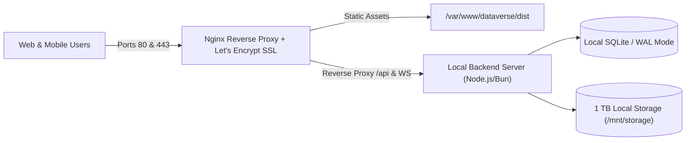

# DataVerse: Self-Hosting & Cloudflare Tunnel Migration Guide

This operational guide provides step-by-step instructions to run DataVerse on your own hardware or VPS (**4 GB RAM / 1 TB Storage**). It covers two distinct architectural paths:

* **Option A: 100% Standalone Self-Hosted Server** (No Cloudflare services: Nginx, Certbot SSL, local SQLite/Postgres, local disk storage).
* **Option B: Self-Hosted Server with Cloudflare Tunnel (`cloudflared`)** (Recommended: Your server runs compute and storage, while Cloudflare handles DDoS defense, SSL, Edge caching, and zero open router ports).

---

## Architecture Comparison

| Feature | Option A: 100% Standalone | Option B: Cloudflare Tunnel (Recommended) |
| :--- | :--- | :--- |
| **Server Location** | VPS with Public Static IP | Any PC / Home Server / VPS (Even behind CGNAT) |
| **Router Port Forwarding** | Required (Ports 80 & 443 open to the public) | **Zero Open Ports** (Encrypted outbound tunnel only) |
| **SSL / HTTPS** | Certbot / Let's Encrypt (Manual renewal cron) | **Automatic Edge SSL** managed by Cloudflare |
| **DDoS Protection** | Server-level iptables / fail2ban | **Cloudflare Global Anycast DDoS Shield** |
| **Global Edge Caching** | None (All media downloads hit your home uplink) | **Cloudflare Edge Cache** serves static assets & media |
| **Daily Request Limits** | **Unlimited (0 limits)** | **Unlimited (0 limits on your origin server)** |
| **1 TB Disk Utilization**| Direct local filesystem access | Direct local filesystem access |

---

## Option B: Self-Hosted Server with Cloudflare Tunnel (Recommended)

In this setup, your 4 GB / 1 TB machine does 100% of the heavy lifting (database queries, WebSocket connections, storing videos and photos on your 1 TB disk), while an outbound lightweight tunnel daemon (`cloudflared`) links it securely to your domain.

```mermaid
flowchart LR
    User["Mobile / Desktop User"] -->|HTTPS / WSS| CF["Cloudflare Edge (SSL & DDoS Shield)"]
    CF -->|Encrypted Outbound Tunnel\n(No open router ports)| Daemon["cloudflared daemon (Your Server)"]
    Daemon -->|HTTP localhost:3000| Frontend["Frontend (Vite Static Build / Nginx)"]
    Daemon -->|HTTP / WS localhost:8787| Backend["DataVerse Backend (Node/Bun Server)"]
    Backend --> DB[(Local SQLite Database)]
    Backend --> Disk[("1 TB Local Media Directory")]
```

---

### Step 1: Install Node.js, Bun, and PM2 on Your Server

Log in to your Ubuntu/Debian server and update dependencies:

```bash
sudo apt update && sudo apt upgrade -y
sudo apt install -y curl git build-essential sqlite3

# Install Node.js (v20+ LTS)
curl -fsSL https://deb.nodesource.com/setup_20.x | sudo -E bash -
sudo apt install -y nodejs

# Install PM2 Process Manager globally
sudo npm install -g pm2
```

---

### Step 2: Clone the Project and Build the Frontend

```bash
git clone https://github.com/datalex-exe/DataVerse.git
cd DataVerse

# Install dependencies across all workspaces
npm install

# Build the frontend production bundle
npm run build --workspace=frontend
```

---

### Step 3: Run the Backend Locally with the Workerd / Node Adapter

Your backend currently uses Cloudflare Workers APIs. You have two options to run it locally on your machine:

#### Method 1: Using Local Workerd Runtime (Zero Code Changes)
Wrangler has a native C++ runtime (`workerd`) built-in that runs locally on Linux without Cloudflare's cloud:

```bash
cd api
# Starts local backend on port 8787 using your local 1 TB disk for storage and local SQLite for D1
npx wrangler dev --local --ip 127.0.0.1 --port 8787 --persist-to /var/dataverse/storage
```

#### Method 2: Registering it with PM2 (Auto-restart on boot)
Create a file named `ecosystem.config.cjs` in your project root:

```javascript
module.exports = {
  apps: [
    {
      name: "dataverse-api",
      cwd: "./api",
      script: "npx",
      args: "wrangler dev --local --ip 127.0.0.1 --port 8787 --persist-to /var/dataverse/storage",
      restart_delay: 3000,
      env: {
        NODE_ENV: "production"
      }
    },
    {
      name: "dataverse-frontend",
      cwd: "./frontend",
      script: "npx",
      args: "serve -s dist -l 3000",
      restart_delay: 3000
    }
  ]
};
```

Start the services with PM2:
```bash
sudo mkdir -p /var/dataverse/storage
sudo chown -R $USER:$USER /var/dataverse

pm2 start ecosystem.config.cjs
pm2 save
pm2 startup
```

---

### Step 4: Install and Authenticate `cloudflared`

Install the official Cloudflare tunnel client on your Linux machine:

```bash
# Download cloudflared package
curl -L --output cloudflared.deb https://github.com/cloudflare/cloudflared/releases/latest/download/cloudflared-linux-amd64.deb
sudo dpkg -i cloudflared.deb

# Authenticate with your Cloudflare account
cloudflared tunnel login
```
*(This opens a browser link to select your domain name).*

---

### Step 5: Create and Configure Your Tunnel

1. **Create the tunnel:**
   ```bash
   cloudflared tunnel create dataverse-home
   ```
   *(Note the Tunnel ID output on screen, e.g. `d3b07384-xxxx-xxxx-xxxx-xxxxxxxxxxxx`)*.

2. **Create the tunnel configuration file:**
   Create `/home/$USER/.cloudflared/config.yml`:

   ```yaml
   tunnel: <YOUR-TUNNEL-ID>
   credentials-file: /home/<USER>/.cloudflared/<YOUR-TUNNEL-ID>.json

   ingress:
     # Route API & Realtime WebSockets to backend port 8787
     - hostname: dataverse.yourdomain.com
       path: /api/*
       service: http://127.0.0.1:8787
       originRequest:
         noTLSVerify: true

     # Route all web UI requests to frontend port 3000
     - hostname: dataverse.yourdomain.com
       service: http://127.0.0.1:3000

     # Catch-all rule (Required by cloudflared)
     - service: http_status:404
   ```

3. **Route your DNS hostname to the tunnel:**
   ```bash
   cloudflared tunnel route dns dataverse-home dataverse.yourdomain.com
   ```

4. **Install and run the tunnel as a background systemd service:**
   ```bash
   sudo cloudflared service install
   sudo systemctl start cloudflared
   sudo systemctl enable cloudflared
   ```

> [!TIP]
> **Why this option is optimal:** Your 1 TB storage and 4 GB RAM now power the entire database and media vault without burning a single request from the Cloudflare free quota. Cloudflare's Anycast network shields your home/server IP address and delivers free, automated SSL certificates.

---

## Option A: 100% Standalone Self-Hosted (No Cloudflare)

Use this option if you want to run completely independent of Cloudflare on a VPS (DigitalOcean, Hetzner, AWS EC2, or a server with a static public IP).



---

### Step 1: Firewall Setup (UFW)

```bash
sudo ufw default deny incoming
sudo ufw default allow outgoing
sudo ufw allow 22/tcp      # SSH
sudo ufw allow 80/tcp      # HTTP (for SSL challenge)
sudo ufw allow 443/tcp     # HTTPS
sudo ufw enable
```

---

### Step 2: Nginx Web Server Configuration

Install Nginx:
```bash
sudo apt install -y nginx certbot python3-certbot-nginx
```

Create `/etc/nginx/sites-available/dataverse`:

```nginx
# Map WebSocket upgrade headers
map $http_upgrade $connection_upgrade {
    default upgrade;
    ''      close;
}

server {
    listen 80;
    server_name dataverse.yourdomain.com;

    # Allow large uploads up to 2 GB for videos
    client_max_body_size 2048M;

    # Frontend Static Single Page App (SPA)
    location / {
        root /var/www/dataverse/dist;
        index index.html;
        try_files $uri $uri/ /index.html;
    }

    # API & WebSocket Proxy
    location /api/ {
        proxy_pass http://127.0.0.1:8787;
        proxy_http_version 1.1;

        # WebSocket support
        proxy_set_header Upgrade $http_upgrade;
        proxy_set_header Connection $connection_upgrade;

        proxy_set_header Host $host;
        proxy_set_header X-Real-IP $remote_addr;
        proxy_set_header X-Forwarded-For $proxy_add_x_forwarded_for;
        proxy_set_header X-Forwarded-Proto $scheme;

        # Timeouts for persistent WebSockets
        proxy_read_timeout 86400s;
        proxy_send_timeout 86400s;
    }

    # High-Performance Caching for Media on Local 1 TB Disk
    location /api/media/file/ {
        proxy_pass http://127.0.0.1:8787;
        expires 365d;
        add_header Cache-Control "public, max-age=31536000, immutable";
        proxy_buffering on;
        proxy_cache_valid 200 206 365d;
    }
}
```

Enable the site and obtain a free SSL certificate:

```bash
sudo ln -s /etc/nginx/sites-available/dataverse /etc/nginx/sites-enabled/
sudo nginx -t
sudo systemctl reload nginx

# Run Certbot to generate and auto-install SSL
sudo certbot --nginx -d dataverse.yourdomain.com
```

---

### Step 3: Copy Frontend Build into Nginx Directory

```bash
sudo mkdir -p /var/www/dataverse
sudo cp -r /home/$USER/DataVerse/frontend/dist /var/www/dataverse/
sudo chown -R www-data:www-data /var/www/dataverse
```

---

## Code Adapter: Mapping Cloudflare APIs to Standard Node / SQLite

If you ever wish to replace the Cloudflare `c.env` bindings with standard Node.js libraries, use this mapping blueprint:

| Cloudflare Native API | Node.js / Linux Equivalent | How to Implement in Code |
| :--- | :--- | :--- |
| `c.env.DB` (D1) | `better-sqlite3` | `const db = new Database('/var/dataverse/db.sqlite');`<br>Enable WAL mode: `db.pragma('journal_mode = WAL');` |
| `c.env.SESSION_KV` | `ioredis` or Local Keyv | `const redis = new Redis();`<br>`await redis.get(key);` |
| `c.env.CHAT_ROOM` (Durable Objects) | `ws` package | Standard Node.js `WebSocketServer`<br>Keep sockets in a JavaScript `Map<convoId, Set<WebSocket>>()`. |
| Media Files | Node `fs.promises` | Save uploads directly to your 1 TB mount: `/mnt/storage/media/${key}`. |

---

## Maintenance & Automatic Daily Backups

Set up an automated daily database backup to your 1 TB drive:

```bash
# Open crontab
crontab -e
```

Add this line to back up the SQLite database every night at 3:00 AM:
```cron
0 3 * * * sqlite3 /var/dataverse/storage/db.sqlite ".backup '/var/dataverse/storage/backup_$(date +\%F).sqlite'"
```
