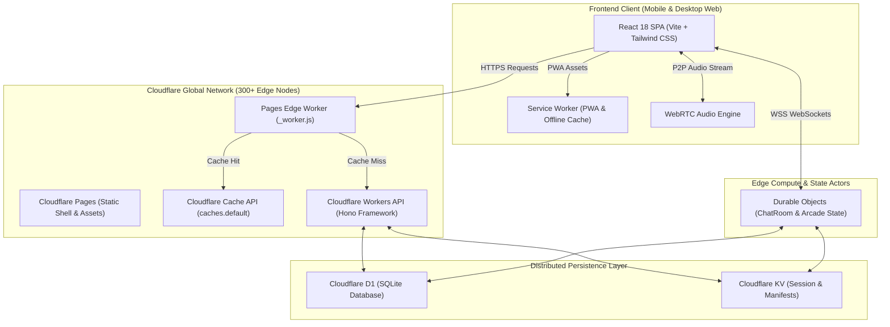
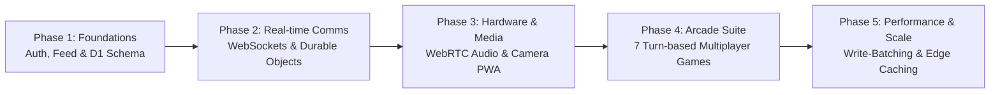
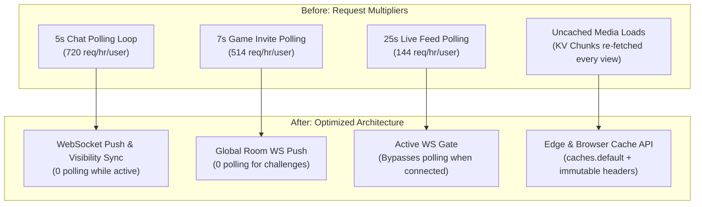

# DataVerse: Comprehensive Technical Architecture & Engineering Evolution

---

## 1. Executive Summary & Platform Overview

**DataVerse** is a modern, high-performance social platform and decentralized real-time arcade built on an edge-native, serverless architecture. Combining social media primitives (media feeds, stories, rich comments, creator profiles, nested collections) with real-time peer-to-peer audio communications and 1v1 turn-based arcade gameplay, DataVerse was engineered to deliver sub-100ms latency globally with zero dedicated container servers.



---

## 2. Technology Stack & Programming Languages

The entire DataVerse codebase is unified in end-to-end **TypeScript**, enforcing strict type safety from database query bindings to client React hooks.

| Domain | Technology / Library | Purpose & Rationale |
| :--- | :--- | :--- |
| **Language** | **TypeScript 5.5+** | End-to-end compile-time contract enforcement across API and UI. |
| **Frontend Framework** | **React 18.3.1** | Component-driven UI with state hooks, portals, and memoization. |
| **Build Tooling** | **Vite 5.4+** | Rollup-based asset optimization, instant HMR, tree-shaking, and code splitting. |
| **Styling** | **Tailwind CSS 3.4+** | Utility-first CSS with dark-mode theme tokens and fluid mobile responsiveness. |
| **Icons & Media UI** | **Lucide React** | Featherweight tree-shaken vector icons. |
| **Edge Compute** | **Cloudflare Workers** | V8-isolate serverless compute with 0ms cold starts. |
| **Server Framework** | **Hono 4.x** | Ultra-lightweight edge router designed specifically for Workers. |
| **Actor Runtime** | **Durable Objects** | Single-threaded in-memory actor runtime for low-latency WebSockets & state. |
| **Relational Database** | **Cloudflare D1** | Serverless SQLite at the edge with regional read replication. |
| **Key-Value Store** | **Cloudflare KV** | Globally distributed, high-read eventually consistent key-value storage. |
| **Calling Protocol** | **WebRTC (Native Browser APIs)** | P2P full-duplex encrypted audio transmission with STUN negotiation. |
| **Hosting & CI/CD** | **Cloudflare Pages & Wrangler** | Edge git deployments, preview environments, and asset pipelines. |

---

## 3. Core Phased Evolution of the Codebase

DataVerse evolved through structured engineering phases, expanding from a lightweight social feed into a full-featured social platform:



1. **Phase 1: Core Social Engine & Storage**
   - Implemented JWT session authorization with 2FA TOTP backup encryption.
   - Built D1 relational schema covering users, posts, comments, likes, notifications, and media metadata.
   - Built mobile-first feed with infinite scrolling, bookmarking, and nested user collections.

2. **Phase 2: Real-Time Messaging & Durable Objects**
   - Implemented Cloudflare Durable Objects (`ChatRoom`) to handle bidirectional WebSockets.
   - Added typing indicators, real-time message read receipts, reactions, and online presence heartbeats.

3. **Phase 3: Camera Capture & WebRTC Voice Calling**
   - Implemented [`SocialCameraModal.tsx`](file:///d:/Pranjal/Dataverse/frontend/src/camera/SocialCameraModal.tsx) for in-app photo/video recording with lens switching, aspect ratios, and flash simulation.
   - Integrated [`AudioCallModal.tsx`](file:///d:/Pranjal/Dataverse/frontend/src/components/AudioCallModal.tsx) using peer-to-peer WebRTC streams, Google STUN discovery, and in-band call signaling.

4. **Phase 4: Multiplayer Arcade Ecosystem**
   - Introduced seven turn-based 1v1 multiplayer games: *Closest Guess, Dots and Boxes, Connect Four, Word Duel, Number Guess, Reaction Race,* and *Checkers*.
   - Engineered authoritative server-side turn validation in [`arcadeGames.ts`](file:///d:/Pranjal/Dataverse/api/src/arcadeGames.ts) to guarantee zero game state tampering.

5. **Phase 5: Mobile Hardening & Scalability Overhaul**
   - Eliminated mobile layout collapses, fixed stacking contexts via React Portals, and locked background scroll.
   - Overhauled network traffic: batching database writes, introducing edge caching, and switching from polling loops to WebSocket push notifications.

---

## 4. Engineering Challenges & Problem Resolution

During production testing across varying mobile devices, network conditions, and user loads, several complex bugs surfaced:

### Problem 1: The Media Viewer Blackout & Nav Bar Bleed
* **Symptom:** In Admin Media Platform, opening an asset dimmed the background, but the media failed to render, layout jumped on mobile, and the bottom navigation bar remained bright on top of the overlay.
* **Root Cause:**
  1. Stacking Context Trap: The modal was rendered inside a parent container with CSS transforms (`translate3d`) and `backdrop-filter`, trapping `position: fixed` beneath the global bottom nav.
  2. Mobile Viewport Collapse: Sizing with `100vh` triggered layout jumps when browser address bars toggled.
  3. Image/Video Dimensions: Flex container had unconstrained zero heights before media loaded.
* **Resolution:**
  - Portaled the viewer directly to `document.body` via `createPortal(..., document.body)` with `z-[999999]`.
  - Replaced `100vh` with `100dvh` (fallback `100vh`) and added `env(safe-area-inset-*)` padding.
  - Sized elements with `object-fit: contain` and implemented a 10-state UI matrix (skeleton, error retry, missing asset badge, offline warning).

### Problem 2: Feed Mobile Comment Drawer Ghost Clicks & Background Scroll
* **Symptom:** Tapping the comment bubble on mobile web failed to open or closed instantly, and scrolling comments moved the feed underneath.
* **Root Cause:**
  1. Synthetic Ghost Clicks: Mobile touch end events triggered a synthetic click event 300ms later that bubbled to the backdrop, closing the drawer immediately.
  2. Scroll Leaking: Setting `document.body.style.overflow = 'hidden'` on mobile Safari does not prevent touch momentum scrolling on the document element.
* **Resolution:**
  - Added timestamp throttling (`commentsDrawerOpenedAtRef`) to ignore clicks within 450ms of opening.
  - Implemented hard position locking:
    ```typescript
    const scrollY = window.scrollY;
    document.body.style.position = 'fixed';
    document.body.style.top = `-${scrollY}px`;
    document.body.style.width = '100%';
    // Restored window.scrollTo(0, scrollY) on unmount
    ```
  - Added `overscroll-none touch-none` on the backdrop and `overscroll-contain` on the comment list.

### Problem 3: WebRTC Dropped Audio Calls & Candidate Races
* **Symptom:** Intermittent call failures where audio never connected despite both users accepting.
* **Root Cause:** ICE candidates generated by caller or callee arrived at the peer before `pc.setRemoteDescription()` had resolved. Calling `pc.addIceCandidate()` in `have-local-offer` or without a remote description throws a DOMException and discards the candidate.
* **Resolution:**
  - Added an internal queue (`pendingCandidatesRef`). If an ICE candidate arrives before remote description is active, it is buffered and flushed immediately after `setRemoteDescription` completes:
    ```typescript
    await pc.setRemoteDescription(new RTCSessionDescription(signal.sdp));
    await drainPendingCandidates(pc);
    ```

---

## 5. The Scalability Overhaul: Taming the 100k Request Burn

When testing active chats and media uploads, Cloudflare Workers' daily limit of 100,000 requests was burning out within hours. A forensic audit discovered 4 major architectural bottlenecks:



### 1. Eliminating High-Frequency Polling
* **Chat Polling:** Removed `setInterval(() => fetchConversations(false), 5000)` in [`Chat.tsx`](file:///d:/Pranjal/Dataverse/frontend/src/pages/Chat.tsx). Real-time message arrivals already update conversation state over WebSockets. Polling was eliminated and replaced with a tab re-entry sync (`visibilitychange`).
* **Game Challenges:** Removed `setInterval(checkPendingInvites, 7000)` in [`GameChallengeModal.tsx`](file:///d:/Pranjal/Dataverse/frontend/src/components/GameChallengeModal.tsx). Challenges are now pushed via Durable Objects to `room_global` and the recipient's WebSocket.
* **Feed Live Posts:** In [`Feed.tsx`](file:///d:/Pranjal/Dataverse/frontend/src/pages/Feed.tsx), the 25s fallback interval now skips execution whenever the WebSocket is in `OPEN` state.

### 2. D1 Database Write-Batching & Profile Caching
* **The Problem:** In SQLite / D1, writes are serialized. Every chat message executed an individual `SELECT` for sender metadata, followed by an immediate `INSERT INTO messages`.
* **The Optimization:**
  1. In-Memory User Profile Caching: Durable Objects cache user records in memory (`userCache`) with a 2-minute TTL, eliminating repeated database reads during conversations.
  2. Zero-Latency Message Dispatch: The message is sent to all room WebSockets **immediately**, before database operations run.
  3. Batched Message Inserts: Messages are queued in memory and committed in batches using `c.env.DB.batch([...])` every 1.5 seconds or every 20 messages. This reduces database write transactions by **up to 95%**.

### 3. Edge & Browser Caching for Media Assets
* **The Problem:** Every image or avatar view fetched content from KV or D1, consuming subrequests.
* **The Optimization:**
  - In [`index.ts`](file:///d:/Pranjal/Dataverse/api/src/index.ts), added:
    ```http
    Cache-Control: public, max-age=31536000, s-maxage=31536000, immutable
    ETag: "<media-key>"
    ```
  - Added an `If-None-Match` fast check that returns HTTP `304 Not Modified` instantly without touching KV or D1.
  - In [`_worker.js`](file:///d:/Pranjal/Dataverse/frontend/public/_worker.js), integrated Cloudflare's `caches.default`. Once an asset is requested once in a geographic region, Cloudflare Edge serves it directly from memory to all subsequent visitors.

---

## 6. Current Deployment Status

The application is deployed across Cloudflare's edge network:
- **Worker Backend:** Version `ceb8e735` / `53627aca` (`https://dataverse-api.24216287.workers.dev`)
- **Frontend Pages:** Deployment `f983e937` (`https://dataverse-datalex.pages.dev`)
- **Repository:** Clean, synchronized on GitHub `main` branch.
